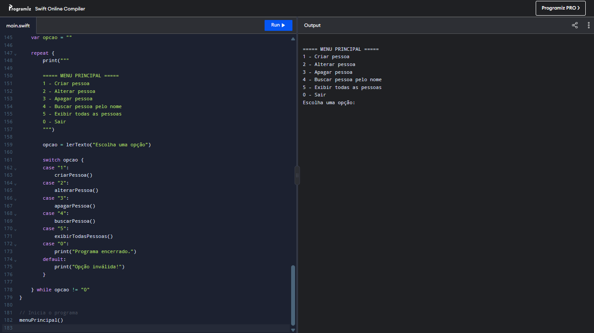

#Tela de Demonstração 



# CRUD de Pessoas em Swift

Projeto desenvolvido para praticar os fundamentos da linguagem Swift por meio de um sistema de cadastro e gerenciamento de pessoas.

## Funcionalidades

- Cadastro de pessoas
- Validação de campos obrigatórios
- Prevenção de nomes duplicados, ignorando maiúsculas e minúsculas
- Alteração de dados cadastrados
- Exclusão de pessoas
- Busca e exibição dos dados de uma pessoa pelo nome
- Listagem de todas as pessoas cadastradas
- Menu interativo no console

## Tecnologias e conceitos

- Swift
- Dicionários (`Dictionary`)
- Arrays
- Funções
- Estruturas condicionais (`if` e `guard`)
- Estrutura de repetição (`repeat-while`)
- Estrutura de seleção (`switch`)
- Entrada de dados com `readLine()`

## Estrutura dos dados

Os dados são armazenados em um dicionário do tipo:

```swift
var pessoas: [String: [String]] = [:]
```

- **Chave:** nome da pessoa.
- **Valor:** array de strings contendo e-mail, telefone e idade.

O armazenamento é feito em memória. Portanto, os dados são perdidos quando o programa é encerrado.

## Como executar

O projeto pode ser executado online pelo [Programiz — Swift Online Compiler](https://www.programiz.com/online-compiler/5X1hslfTZQgld) ou

1. Copie o código-fonte para o editor Swift.
2. Clique em **Run**.
3. Escolha uma opção no menu principal.
4. Utilize as opções para testar as funcionalidades.

## Objetivo acadêmico

Praticar os fundamentos da programação em Swift por meio da implementação das operações CRUD (*Create, Read, Update e Delete*).

---

Projeto desenvolvido para fins educacionais.
